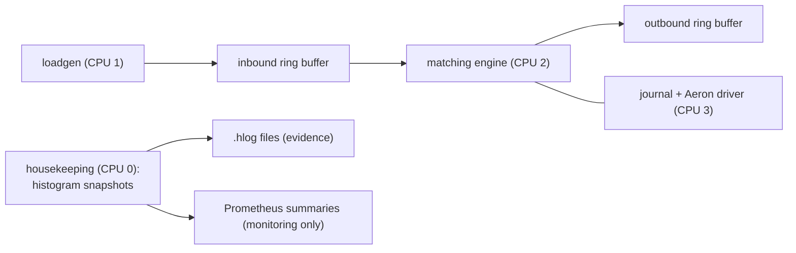
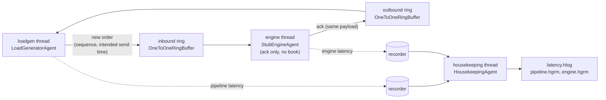

# Low-Latency Matching Engine (Java)

[](https://github.com/Jeromefromcn/low-latency-matching-engine/actions/workflows/build.yml)

A limit-order-book matching engine that explores how far tail latency can be pushed on the JVM — with every number backed by raw, reproducible measurement data.

> **Status:** Phase 0 complete — build, CI, formatting and an end-to-end walking skeleton (no matching logic yet). Next: Phase 2, the matching engine. See [`docs/ROADMAP.md`](docs/ROADMAP.md).

## Goals

- **Deterministic tail latency.** Target microsecond-level p99.9/p99.99 and max, not averages.
- **Zero allocation on the hot path**, proven by JMH `-prof gc` and GC-free steady-state runs.
- **Provable correctness.** Property-based tests, a reference-model differential test, and byte-identical deterministic replay.
- **Honest measurement.** Constant-rate (open-model) load to avoid coordinated omission; HdrHistogram logs committed for every published number.

## Design at a glance



The diagram is the target design. What exists today is described below.

## Repository layout

| Path | Responsibility | Contents today |
|---|---|---|
| [`common/`](common/) | Wire format and constants shared by every module. SBE schemas and generated codecs arrive in ROADMAP 2.1. | `SkeletonProtocol` (placeholder 16-byte message layout), `LatencyRecording` (histogram range: 10 s, 3 significant digits) |
| [`engine-core/`](engine-core/) | Order book and matching logic: a pure, single-threaded, deterministic state machine with no I/O, threads or clocks. | Empty until Phase 2 |
| [`engine-app/`](engine-app/) | Process wiring: ring buffers, agent threads, idle strategies, CPU affinity, latency histograms, `.hlog` output. | Walking skeleton (see below) |
| [`loadgen/`](loadgen/) | Open-model, constant-rate load generator. Latency is measured from each message's *intended* send time, so stalls are not hidden (coordinated omission). | `ConstantRateSchedule`, `LoadGeneratorAgent` |
| [`bench-jmh/`](bench-jmh/) | JMH micro-benchmarks. | `BaselineBenchmark`: the JMH-infrastructure allocation floor that engine benchmarks are compared against |
| [`build-logic/`](build-logic/) | Gradle convention plugins applied by every module: Java 25 toolchain, `-Xlint:all -Werror`, JUnit/jqwik, Spotless (palantir-java-format), JMH, Agrona JVM flags. | |
| [`gradle/libs.versions.toml`](gradle/libs.versions.toml) | Every dependency version, in one place. | |
| [`scripts/`](scripts/) | `run-skeleton.sh` (runs the skeleton); `platform/` holds machine tuning and noise-baseline scripts. | |
| [`bench/`](bench/) | Committed raw evidence only: results generated deliberately to back a published claim. | |
| [`docs/`](docs/) | Roadmap, benchmark methodology, ADRs, runbooks. | |

### Walking skeleton (ROADMAP 0.4)

One process, three threads, each an Agrona `Agent` with exactly one writer per piece of state:



| Class | Role |
|---|---|
| `SkeletonMain` | Entry point: parses the configuration, builds the rings and recorders, starts the three threads, waits for the run to finish. Exit code 0 completed, 1 configuration error, 2 `.hlog` truncated by its byte cap. |
| `SkeletonConfig` | `key=value` arguments over a profile: `dev` (sleeping idle strategy, no pinning) or `bench` (busy-spin, core allocation from `CLAUDE.md`). Pinning arrives in ROADMAP 3.1; until then, requesting it fails at start-up. |
| `LoadGeneratorAgent` | Sends every message that is due by the schedule; records *pipeline latency* = ack observed − intended send time. |
| `StubEngineAgent` | Acknowledges each message; records *engine latency* = inbound read → ack written. Replaced by the real engine in 3.1. |
| `HousekeepingAgent` | Discards warm-up samples, writes one interval per tag per log interval to `latency.hlog`, writes a `.hgrm` per tag at the end, and enforces the byte cap. |
| `RunPlan` | Warm-up, measurement window, log interval and byte cap of one run. |

Key decisions are recorded as ADRs:

- [0001 — Separate the measurement plane from the monitoring plane](docs/adr/0001-measurement-vs-monitoring-plane.md)
- [0002 — In-process ring buffers / Aeron instead of Kafka on the message path](docs/adr/0002-aeron-ipc-over-kafka.md)
- [0003 — Gradle first, Maven parity later](docs/adr/0003-build-tool-gradle-first.md)
- [0004 — Hot-path processes run on bare metal, not in containers](docs/adr/0004-deployment-bare-metal-hot-path.md)

## Results

Headline numbers will appear here once Phase 3 is complete, each linked to its raw data under [`bench/`](bench/).

Platform noise baseline (untuned vs tuned machine): [`bench/platform/`](bench/platform/) — Phase 1.

## Benchmark machine

Intel Core i5-10300H laptop, 4 cores (SMT disabled), turbo off, frequency locked at 2.5 GHz, CPUs 1–3 isolated, Ubuntu Server 24.04, Java 25. Full procedure: [`docs/runbooks/01-platform-setup.md`](docs/runbooks/01-platform-setup.md). Methodology: [`docs/benchmark-methodology.md`](docs/benchmark-methodology.md).

Consumer hardware is a deliberate constraint: the point is the method and the relative gains, measured honestly, including the noise floor the hardware cannot remove.

## Building

```
./gradlew build
```

Requires a JDK 25 for the Gradle toolchain; the wrapper downloads Gradle itself.

## Running

```
scripts/run-skeleton.sh                              # day-to-day: dev profile, 10 s warm-up + 60 s
scripts/run-skeleton.sh rate=20000 durationSeconds=30
EVIDENCE=1 scripts/run-skeleton.sh                   # evidence run, to be committed under bench/
```

A **day-to-day run** writes to `build/runs/skeleton/` (git-ignored) and replaces the previous run, so nothing accumulates. An **evidence run** is generated deliberately when a result is going to be published: it requires a clean working tree and writes a new `bench/skeleton/<label>-<timestamp>/` with the full layout from the [methodology](docs/benchmark-methodology.md) §7, including an environment snapshot.
