# Architecture — current state

This document describes the system **as it is now**, not as it is planned. It is updated in the same commit as any change to what it describes (see `CLAUDE.md` → Workflow rules).

- **Why** a decision was made: [`docs/adr/`](adr/). This document links to ADRs and does not repeat their reasoning.
- **What comes next**: [`docs/ROADMAP.md`](ROADMAP.md). Planned parts appear here only in [§10 Not built yet](#10-not-built-yet), never mixed into the description of what exists.
- **How to measure**: [`docs/benchmark-methodology.md`](benchmark-methodology.md).

**Current as of:** ROADMAP Phase 0 complete (0.1–0.4). Walking skeleton only; there is no order book or matching logic yet.

Contents:

1. [System overview](#1-system-overview)
2. [Modules and dependencies](#2-modules-and-dependencies)
3. [Threads and state ownership](#3-threads-and-state-ownership)
4. [Message flow](#4-message-flow)
5. [Wire format and ring buffers](#5-wire-format-and-ring-buffers)
6. [Latency measurement](#6-latency-measurement)
7. [Run lifecycle](#7-run-lifecycle)
8. [Configuration](#8-configuration)
9. [Build, CI and run modes](#9-build-ci-and-run-modes)
10. [Not built yet](#10-not-built-yet)
11. [Invariants and how they are enforced](#11-invariants-and-how-they-are-enforced)

---

## 1. System overview

Today the system is a single JVM process: a constant-rate load generator sends messages through an inbound ring buffer to a stub engine, which acknowledges each one through an outbound ring buffer. Latency is recorded on both hot-path threads and written to disk by a housekeeping thread. Only the measurement plane exists; the monitoring plane (Prometheus/Grafana, ADR 0001) is not built yet (ROADMAP 3.5).

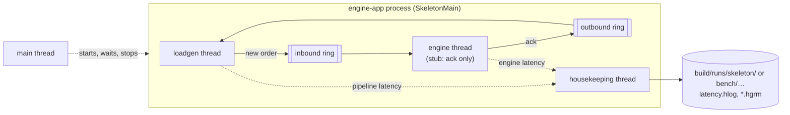

## 2. Modules and dependencies

| Module | Responsibility | Contents today |
|---|---|---|
| `common` | Wire format and constants shared by all modules. SBE schemas and codecs from ROADMAP 2.1. | `SkeletonProtocol` (placeholder message layout), `LatencyRecording` (histogram range) |
| `engine-core` | Order book and matching: a pure, single-threaded, deterministic state machine `(state, event) -> (state', events)`. No I/O, threads or clocks. | Empty |
| `engine-app` | Process wiring: rings, threads, idle strategies, affinity, recorders, `.hlog` output. | Walking skeleton |
| `loadgen` | Open-model, constant-rate load generation; latency from intended send time. | `ConstantRateSchedule`, `LoadGeneratorAgent` |
| `bench-jmh` | JMH micro-benchmarks. | `BaselineBenchmark` (JMH allocation floor) |
| `build-logic` | Gradle convention plugins applied by every module (§9). | `mle.java-conventions`, `mle.jmh-conventions`, `AgronaJvmArgs` |

Project and library dependencies as declared in the build files:

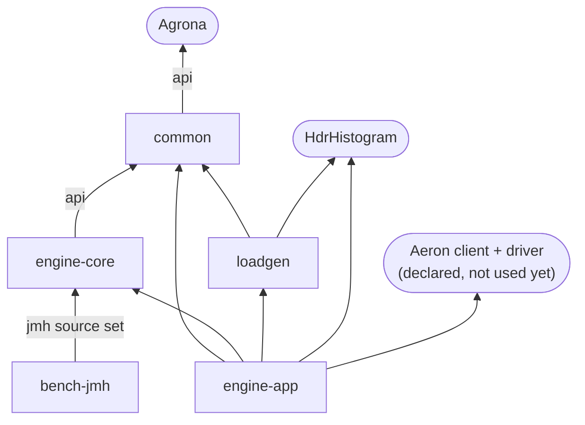

Notes:

- `engine-app` depends on `loadgen` only because the skeleton runs the load generator in the same process. ROADMAP 3.4 moves it into its own process (pinned to CPU 1).
- `engine-core` has no dependency on Aeron, HdrHistogram or anything thread- or clock-related; it reaches Agrona only for buffers and primitive collections.

## 3. Threads and state ownership

Every hot-path thread is an Agrona `Agent` driven by an `AgentRunner`: a duty-cycle loop calling `doWork()` and idling with the configured `IdleStrategy` when no work was done. Each piece of mutable state has exactly one writing thread (single-writer principle).

| Thread | Agent | Idle strategy | Writes | Reads |
|---|---|---|---|---|
| loadgen | `LoadGeneratorAgent` | profile (§8) | inbound ring (producer); pipeline recorder; its own sequence counter | outbound ring (consumer) |
| engine | `StubEngineAgent` | profile (§8) | outbound ring (producer); engine recorder | inbound ring (consumer) |
| housekeeping | `HousekeepingAgent` | `SleepingMillisIdleStrategy(1)` | output files; run outcome (`volatile`) | both recorders (reader side) |
| main | — (`SkeletonMain`) | sleeps 10 ms between checks | — | run outcome; first agent error |

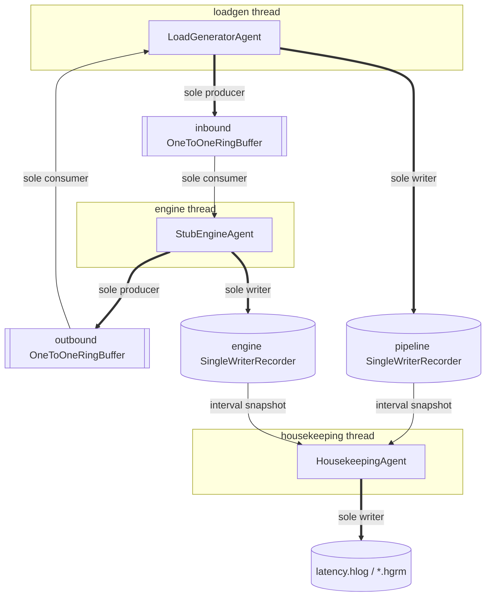

Thick arrows are writes, thin arrows are reads. `OneToOneRingBuffer` and `SingleWriterRecorder` are both single-producer by design; a second writer would be a bug, not a contention problem.

CPU pinning: each thread has a configured CPU (`cpu.loadgen`, `cpu.engine`, `cpu.housekeeping`; `-1` = unpinned), but pinning is not implemented until ROADMAP 3.1. A configuration that requests pinning fails at start-up (§7).

## 4. Message flow

One message from schedule to acknowledgement, with the clock readings used for latency:

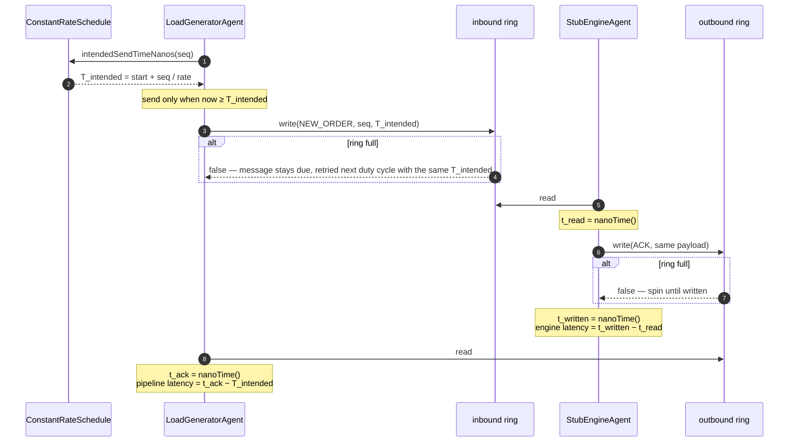

Back-pressure behaviour:

- **Load generator, inbound full:** the message is not dropped and not rescheduled. It is retried on the next duty cycle and keeps its intended send time, so the delay is charged to pipeline latency (coordinated omission is corrected, not hidden).
- **Engine, outbound full:** the engine spins until the write succeeds. This is a skeleton simplification; ROADMAP 3.1 defines the real back-pressure policy.

## 5. Wire format and ring buffers

### Placeholder message layout (`SkeletonProtocol`)

Replaced by SBE in ROADMAP 2.1. Both message types carry the same payload; the ack echoes it unchanged.

| Offset | Length | Field | Type |
|---|---|---|---|
| 0 | 8 | sequence | `long`, little-endian (Agrona default) |
| 8 | 8 | intended send time | `long`, `System.nanoTime()` domain |

| Message type id | Name | Direction |
|---|---|---|
| 1 | `NEW_ORDER` | loadgen → engine (inbound ring) |
| 2 | `ACK` | engine → loadgen (outbound ring) |

### Ring buffer

Agrona `OneToOneRingBuffer` over a direct `ByteBuffer` of `ringCapacity` bytes plus the trailer (`RingBufferDescriptor.TRAILER_LENGTH`). Default capacity is 1 MiB; it must be a power of two.

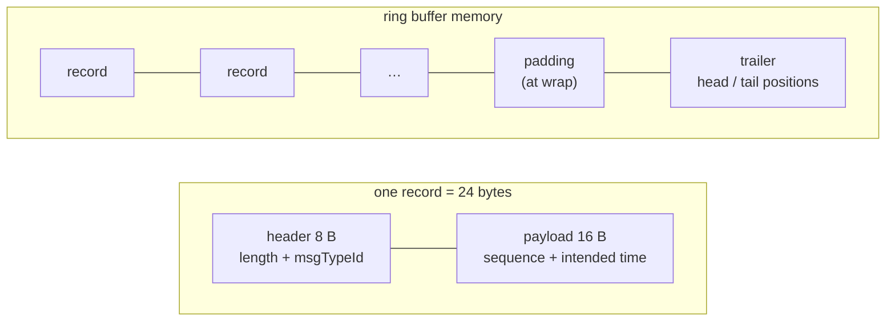

Properties that shape the code:

- Records are 8-byte aligned: header 8 B + payload 16 B = 24 B per message.
- Maximum message length is `capacity / 8`.
- When a record does not fit before the end of the buffer, a padding record fills the gap and the record starts at offset 0. A single `read()` stops at the end of the buffer, so after a wrap one call may return 0 and the next returns the messages. Agents call `read()` every duty cycle, so this is harmless; tests that drain a ring must loop until `consumerPosition == producerPosition`.
- Neither agent allocates per message: each agent is its own `MessageHandler` (no lambda), and the load generator encodes into one reused `UnsafeBuffer`.

## 6. Latency measurement

Measurement plane only (ADR 0001). The `.hlog` is the evidence; nothing else is.

| Tag | From | To | Recorded by |
|---|---|---|---|
| `pipeline` | intended send time (schedule) | ack observed by the load generator | loadgen thread |
| `engine` | inbound message read by the engine | ack written to the outbound ring | engine thread |

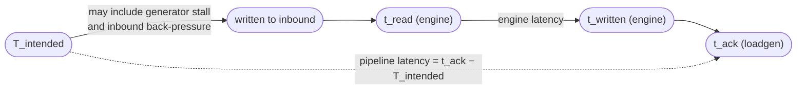

Recorders: one `SingleWriterRecorder` per tag, fixed range 1 ns – 10 s, 3 significant digits (`LatencyRecording`; methodology §5). The range is fixed because an auto-resizing histogram would allocate on the hot path. Values above 10 s are clamped to 10 s.

### Housekeeping state machine

`HousekeepingAgent` turns recorder snapshots into files. Its clock starts when it is constructed, just before the threads start.

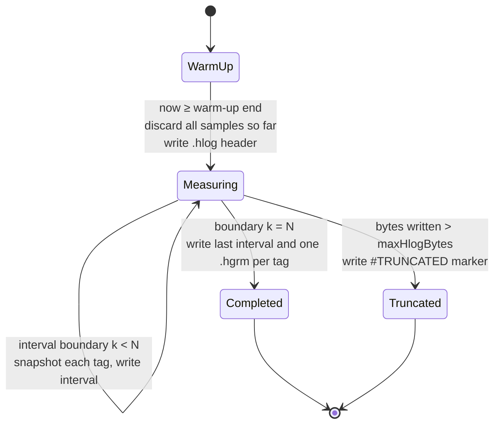

- Interval boundaries are at `warm-up end + k × interval` for `k = 1..N`, with `N = measurement window / interval`. The window must be a whole number of intervals, so the `.hlog` holds exactly `N` intervals per tag.
- The byte cap is checked after each interval, so the log can exceed the cap by at most one interval. A truncated run is invalid: no `.hgrm` is written and the process exits with 2.

### Output files

| File | Content | Units |
|---|---|---|
| `latency.hlog` | HdrHistogram interval log: header, then one line per tag per interval (`Tag=pipeline`, `Tag=engine`) | nanoseconds |
| `pipeline.hgrm`, `engine.hgrm` | Percentile distribution of the whole measurement window | microseconds |

Size: roughly 1 KB per interval line, so a 1 s interval gives about 2 KB/s for two tags (about 1.3 MB for a 10-minute run).

## 7. Run lifecycle

`SkeletonMain.run(args)`; `main` exits with its return value.

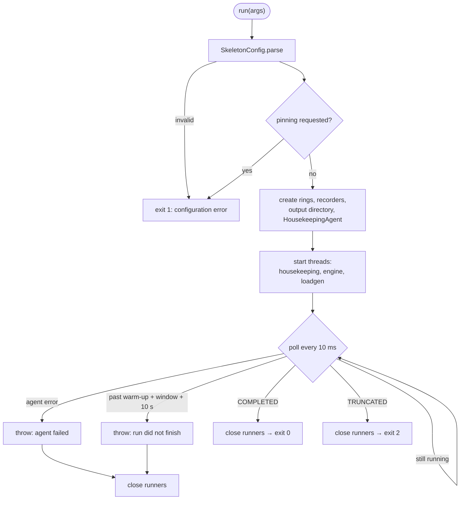

Runners are closed in the order loadgen, engine, housekeeping, also when the run fails. An error inside any agent is passed to the main thread through the `AgentRunner` error handler.

| Exit code | Meaning |
|---|---|
| 0 | Completed: every interval written |
| 1 | Configuration error; no thread started, no file written |
| 2 | Truncated by the `.hlog` byte cap; run is invalid |

## 8. Configuration

Arguments are `key=value`. Values resolve in three layers; an unknown key or value is rejected, so a typo cannot be silently ignored.

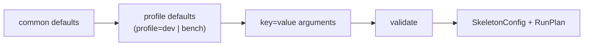

| Key | `dev` | `bench` | Meaning |
|---|---|---|---|
| `outputDir` | required | required | Where the run's files go |
| `rate` | 10000 | 10000 | Messages per second |
| `warmupSeconds` | 10 | 60 | Discarded warm-up |
| `durationSeconds` | 60 | 600 | Measurement window |
| `intervalMillis` | 1000 | 1000 | `.hlog` interval; the window must be a whole number of intervals |
| `maxDurationSeconds` | 3600 | 3600 | Cap on warm-up + window, checked at start-up |
| `maxHlogBytes` | 64 MiB | 64 MiB | Cap on `.hlog` size, checked after every interval |
| `ringCapacity` | 1 MiB | 1 MiB | Each ring; power of two |
| `idle` | `sleeping` | `busy-spin` | Hot-path idle strategy: `sleeping`, `yielding`, `backoff`, `busy-spin` |
| `cpu.loadgen` / `cpu.engine` / `cpu.housekeeping` | -1 / -1 / -1 | 1 / 2 / 0 | CPU per thread; -1 = unpinned. Any value ≥ 0 fails until ROADMAP 3.1 |

The `bench` profile therefore cannot run yet: it requests pinning and fails at start-up with a message pointing to ROADMAP 3.1.

## 9. Build, CI and run modes

### Build

Every module applies a convention plugin from `build-logic`; versions live in `gradle/libs.versions.toml`.

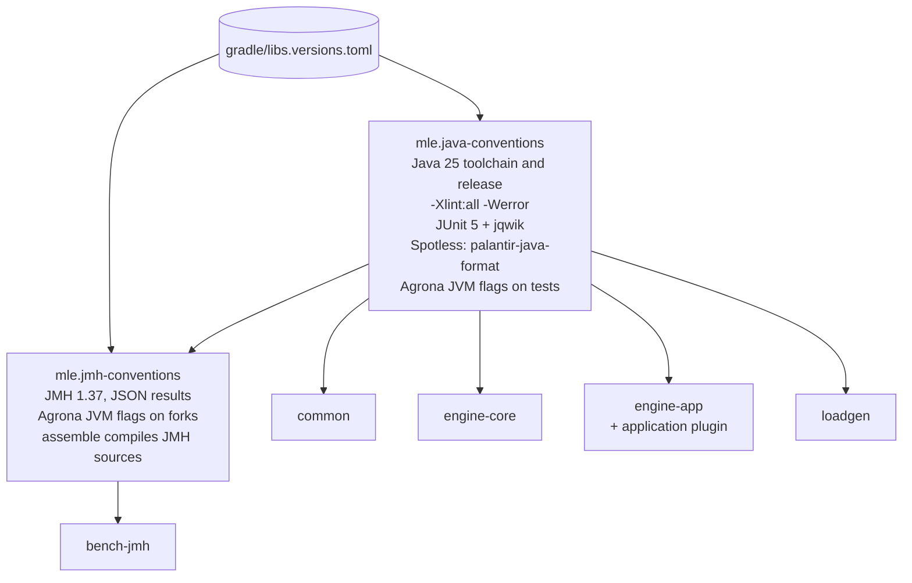

Agrona 2.x needs `--add-exports java.base/jdk.internal.misc=ALL-UNNAMED`. `AgronaJvmArgs` holds the flag once; it is applied to tests, JMH forks and the `engine-app` start script.

### CI

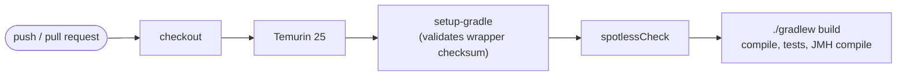

Actions are pinned to commit SHAs; the workflow token has `contents: read` only. CI results are never used for latency numbers.

### Run modes

`scripts/run-skeleton.sh` (methodology §7):

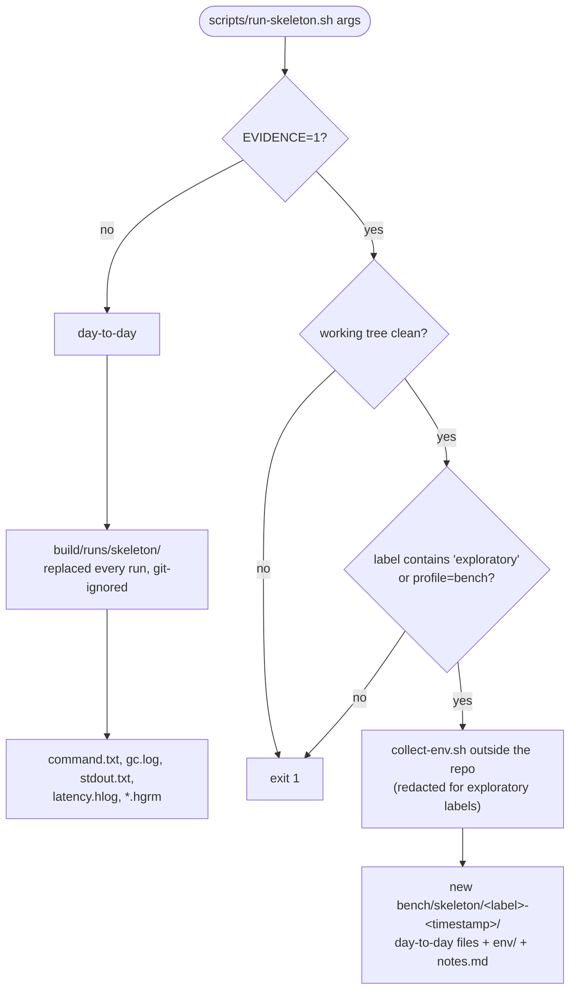

## 10. Not built yet

Target design (README, `CLAUDE.md`), with the ROADMAP task that builds each part. Solid boxes exist today; dashed boxes do not.

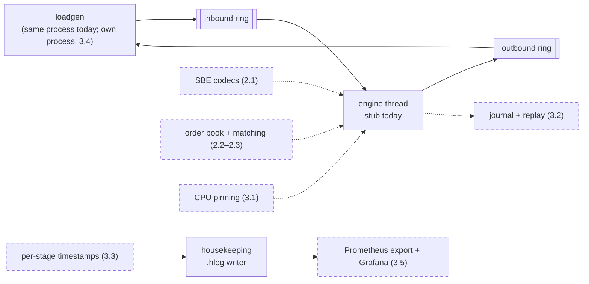

## 11. Invariants and how they are enforced

| Invariant | Enforced by |
|---|---|
| Latency is measured from the intended send time | `LoadGeneratorAgentTest` (stall and back-pressure cases; fails if the actual send time is used) |
| The schedule does not drift | `ConstantRateScheduleTest` (exact integer arithmetic) |
| Warm-up samples are not in the `.hlog` | `HousekeepingAgentTest` |
| The `.hlog` has exactly `window / interval` intervals per tag | `HousekeepingAgentTest`, `SkeletonMainTest` (end to end) |
| Exceeding the byte cap fails the run with a marker | `HousekeepingAgentTest`, `SkeletonMainTest` (exit 2) |
| Requested pinning is never silently ignored | `SkeletonConfigTest`, `SkeletonMainTest` (exit 1) |
| Tests run on Java 25 with JUnit and jqwik both active | `BuildWiringTest` |
| Formatting and compiler warnings | `spotlessCheck` and `-Werror` in every build and in CI |
| `engine-core` has no Aeron, thread or clock dependency | Build file only (no Aeron/HdrHistogram declared). An automated dependency/ArchUnit test arrives with ROADMAP 3.5. |
| Zero allocation on the hot path | Code review against `docs/zero-allocation.md` only. Not yet demonstrated: JMH `-prof gc` arrives in 2.7/3.1, GC-free steady state in 3.6. |
